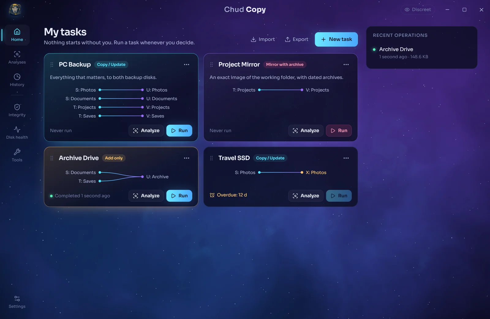
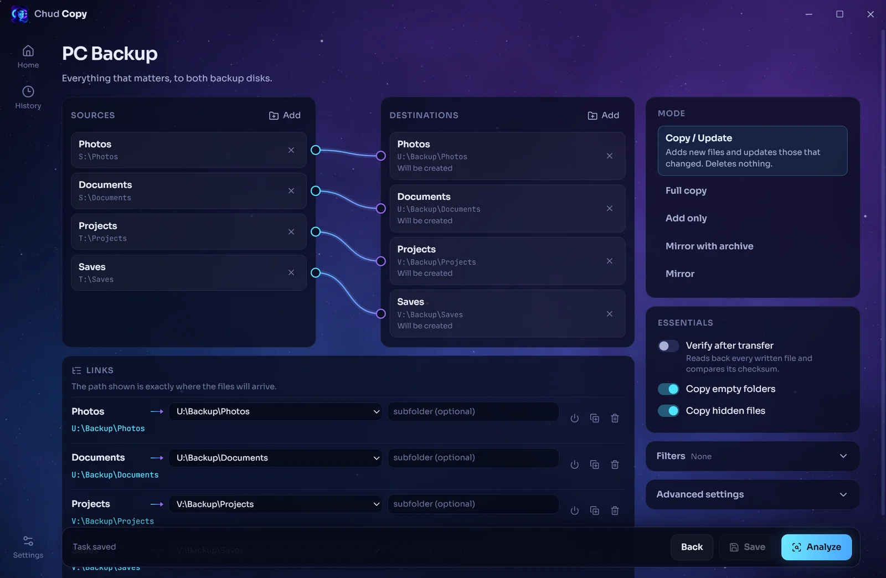
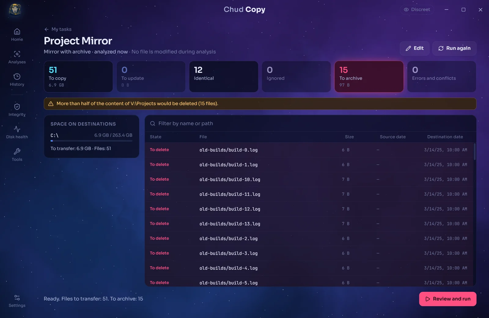
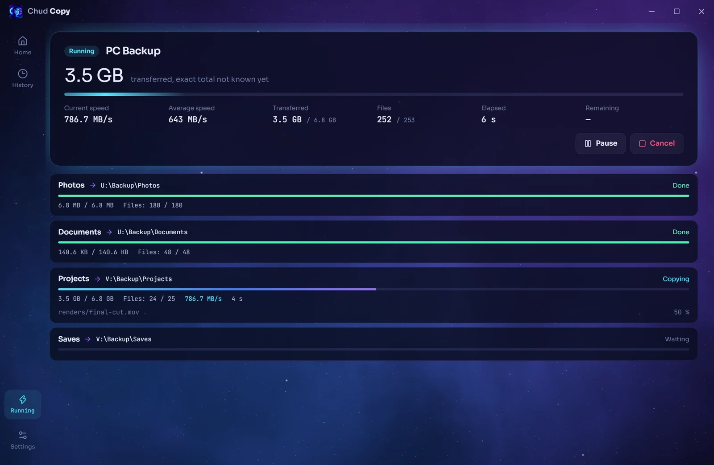
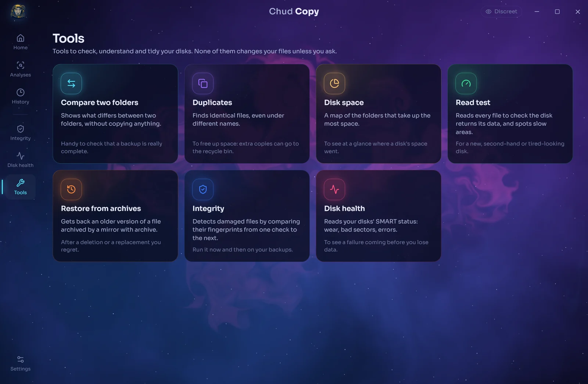
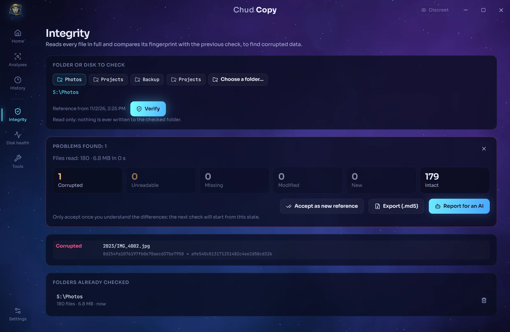

<div align="center">


# Chud Copy

**Set up your copy and sync jobs once. Run them when you decide.**

A local, manual backup tool for Windows and Linux, with the power of a real sync engine and an interface that actually shows you what is about to happen.

[](https://github.com/BigFatDeuce/Chud-Copy/releases/latest)
[](https://github.com/BigFatDeuce/Chud-Copy/releases)


### [Download the latest version](https://github.com/BigFatDeuce/Chud-Copy/releases/latest)



</div>

## Why Chud Copy

Most backup tools are either powerful and intimidating, or simple and opaque. Chud Copy keeps the reliability of a proven engine and adds what command lines lack: a visual map of your folders, and a clear preview of every change before it happens.

It is deliberately simple about one thing: **nothing runs without you.** No cloud account, no background service, no schedule, no folder watching, no surprise when you plug in a disk. Even the update check only happens when you click the button in the settings.

## Features

<table>
<tr>
<td width="50%" valign="top">

### Map your folders visually

Pick sources and destinations, then draw the links between them. One source can feed several destinations, and sources sharing a destination each get their own subfolder, so folder trees never mix by accident.

Give each task its own frame colour, drag tasks into the order you like, and set a reminder for backups you tend to forget.

</td>
<td width="50%"></td>
</tr>
<tr>
<td width="50%"></td>
<td width="50%" valign="top">

### See everything before it happens

Analyze any task without changing a single file. Search through what will be copied, updated, ignored or deleted, compare dates on both sides, and check free space on each destination. Several analyses can run at once, and you can follow them all from one view.

</td>
</tr>
<tr>
<td width="50%" valign="top">

### Follow the real numbers

Speed, time left, files and the current file all come straight from the engine, for each destination. Pause, resume or cancel at any time. A cancelled copy never leaves a half-written file behind. While a copy runs, add other tasks to a queue: they start one after another, and the queue never survives closing the app. The frame burns brighter as the copy goes faster, and a sound tells you when it is done.

</td>
<td width="50%"></td>
</tr>
</table>

## Copy modes

| Mode | What it does | Removes files? |
| --- | --- | --- |
| **Copy / Update** | Adds new files and updates the ones that changed | Never |
| **Full copy** | Copies everything again | Never |
| **Add only** | Adds what is missing, never replaces anything | Never |
| **Mirror with archive** | Exact image of the source, removed files move to a dated archive on the destination | Moved, not deleted |
| **Mirror** | Exact image of the source | Yes, permanently |

Filters cover extensions, names, folders, size and date. An optional checkbox skips files that are not worth backing up, such as Windows profile files, system caches, temporary files and unfinished downloads. Advanced settings stay out of the way until you need them.

## Tools to check your disks

Each tool explains in one sentence what it does, and none of them changes your files unless you ask.

<table>
<tr>
<td width="50%"></td>
<td width="50%"></td>
</tr>
</table>

| Tool | What it does |
| --- | --- |
| **Integrity** | Reads every file and compares its MD5 fingerprint with the previous check, to spot silent corruption. Exports `.md5` files compatible with MD5summer. |
| **Disk health** | Reads SMART data: wear, bad sectors, cable errors, NVMe logs. Each reading is compared with the previous one, so rising counters stand out from old ones. |
| **Compare two folders** | Shows what differs between a backup and its source, without copying anything. |
| **Duplicates** | Finds identical files by content. Extra copies can go to the recycle bin after confirmation; the copy you keep is never touched. |
| **Disk space** | A clickable map of the folders that take up the most space. |
| **Read test** | Reads every file to find unreadable ones and areas of the disk that are abnormally slow. |
| **Restore** | Brings back an archived version of a file into the folder of your choice, without replacing anything. |

Integrity and disk health reports can be copied as a ready-made prompt for the AI of your choice. Tasks can also remind you when a backup has not been run for a while, without ever running it on their own.

## Built to protect your data

- **Your sources are never modified.** Every operation only writes to the destination.
- **A mirror must be analyzed first.** Right before writing, the app compares the real state with the list you approved, and stops without changing anything if a file not on that list would be removed.
- **Risky setups are refused.** Identical or nested folders, a destination overlapping a source, or a mirror aimed at a system folder are all blocked.
- **Suspicious deletions are flagged.** An empty source, which often means an unplugged disk, asks for a stronger confirmation.
- **Missing disks are not a problem.** Your task keeps its paths and tells you what is unavailable.
- **Everything is on record.** Each run keeps a report and a detailed log, and nothing in the history ever restarts by itself. You can erase one report or the whole history at any time.

## Download

Get the files from the [latest release](https://github.com/BigFatDeuce/Chud-Copy/releases/latest).

| System | File | Notes |
| --- | --- | --- |
| Windows | `Chud-Copy_x.y.z_x64-setup.exe` | Installer |
| Windows | `Chud-Copy_x.y.z_x64-portable.zip` | No installation, keep `rclone.exe` next to the app |
| Fedora, Nobara and other RPM distributions | `Chud-Copy-x.y.z-1.x86_64.rpm` | **Recommended on these systems**: uses your system's up-to-date, GPU-accelerated web engine |
| Debian, Ubuntu, Linux Mint, Pop!_OS | `Chud-Copy_x.y.z_amd64.deb` | **Recommended on these systems**: uses your system's web engine |
| Other Linux | `Chud-Copy_x.y.z_amd64.AppImage` | Nothing else to install |

**Windows:** the app is not code-signed yet, so SmartScreen may show a warning. Choose *More info*, then *Run anyway*.

**Fedora, Nobara:** install the RPM, then launch Chud Copy from your applications menu.

```bash
sudo dnf install ./Chud-Copy-*.x86_64.rpm
```

**Debian, Ubuntu and derivatives:** install the DEB, then launch Chud Copy from your applications menu.

```bash
sudo apt install ./Chud-Copy_*_amd64.deb
```

**Other Linux:** make the AppImage executable, then run it. If it complains about FUSE, install `fuse-libs` or add `--appimage-extract-and-run`. The AppImage ships its own web engine, which can be slower than your system's.

```bash
chmod +x Chud-Copy_*_amd64.AppImage
./Chud-Copy_*_amd64.AppImage
```

Your tasks are stored separately from the app, so they survive updates and uninstalls: `%APPDATA%\ChudCopy` on Windows, `~/.local/share/chud-copy` on Linux.

## Languages

English, 简体中文, हिन्दी, Español, العربية, Français, বাংলা, Português, Русский and اردو, with a full right-to-left layout for Arabic and Urdu. The app follows your system language, and you can change it in the settings.

## Good to know

- An interrupted file restarts from the beginning. Files already copied are not copied again.
- On Windows, a file locked by another application is reported and skipped, and the rest of the job continues.
- Files that a cloud service keeps online only are downloaded by that service when they are read for copying.
- Dates are always kept. Permissions and the hidden attribute are kept when the disk allows it. Windows NTFS permissions are not copied.
- Tested on Windows 11 and Fedora 44. Translations were not reviewed by native speakers, so corrections are welcome.

## Credits

Chud Copy is built with [Tauri](https://tauri.app) and React, and copies files with [rclone](https://rclone.org) (MIT). The animated background is based on [WebGL Fluid Simulation](https://github.com/PavelDoGreat/WebGL-Fluid-Simulation) by Pavel Dobryakov (MIT). Fonts are Sora and JetBrains Mono (OFL). License texts ship in the app's `licenses` folder.

This repository hosts release builds only.
